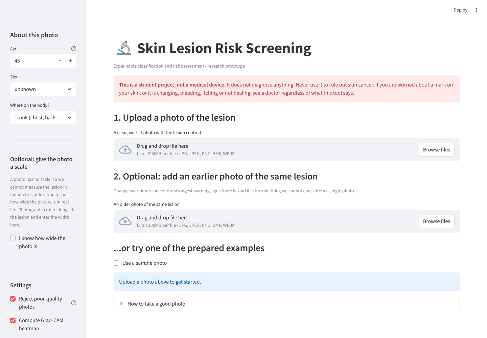
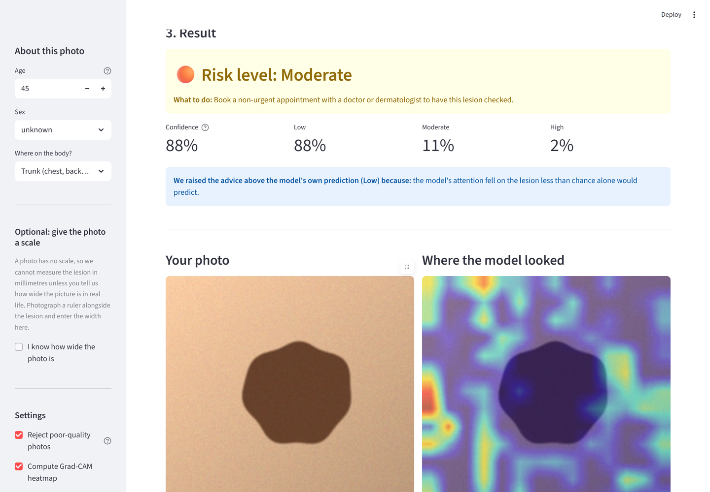
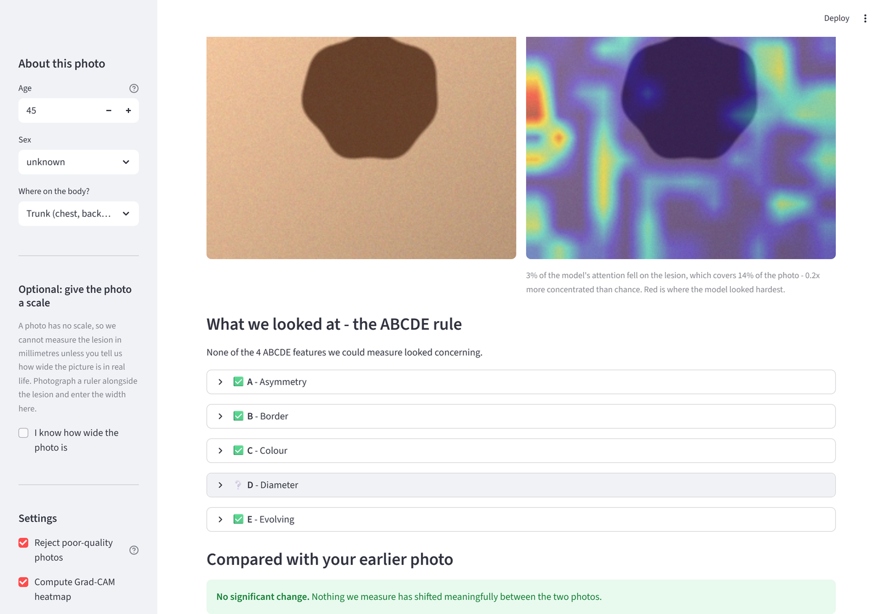
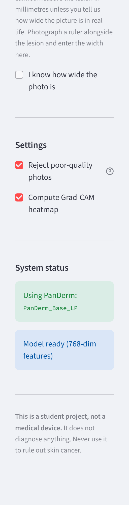

# Skin Cancer Detection with Explainable Classification and Risk Assessment

A patient-facing skin-lesion screening prototype. Upload a phone photo of a
skin lesion plus a few details, and it returns a **Low / Moderate / High** risk
level with a confidence score, a Grad-CAM heatmap showing where the model
looked, a plain-language **ABCDE** explanation, and — if you supply an earlier
photo — a check for whether the lesion has changed.

> ## ⚠️ This is not a medical device
>
> This is a **student research prototype**. It has **not** been clinically
> validated, it is **not** a diagnosis, and its output must **never** be used to
> rule out skin cancer. If you are worried about a mark on your skin — or if it
> is changing, bleeding, itching, or not healing — see a doctor or dermatologist
> regardless of what this tool says.

---

## Contents

- [What it does](#what-it-does)
- [Screenshots](#screenshots)
- [Quick start](#quick-start)
- [Getting the data](#getting-the-data)
- [Label mapping and its limitations](#label-mapping-and-its-limitations)
- [Using PanDerm](#using-panderm)
- [Training and evaluation](#training-and-evaluation)
- [Results](#results)
- [How it works](#how-it-works)
- [Design decisions worth knowing about](#design-decisions-worth-knowing-about)
- [Configuration](#configuration)
- [Testing](#testing)
- [Project layout](#project-layout)
- [Licences and attribution](#licences-and-attribution)

---

## What it does

The pipeline runs in a deliberate order, because a confident-looking number
computed from an unusable photo is the worst possible output for this kind of
tool:

| # | Stage | Module | What it contributes |
|---|-------|--------|---------------------|
| 1 | **Quality gate** | [`src/quality/image_quality.py`](src/quality/image_quality.py) | Blur, exposure, contrast, resolution and framing checks. Fails → retake prompt, no risk score. |
| 2 | **Segmentation** | [`src/segmentation.py`](src/segmentation.py) | One lesion mask shared by everything downstream. |
| 3 | **Feature extraction** | [`src/backbone/`](src/backbone/) | PanDerm ViT-B/16 embedding (768-dim); ImageNet fallback if unavailable. |
| 4 | **Fusion + classification** | [`src/model/`](src/model/) | Image embedding + age/sex/site → risk logits. |
| 5 | **Change detection** | [`src/tracking/change_detection.py`](src/tracking/change_detection.py) | Compares against an earlier photo; supplies the "E" in ABCDE. |
| 6 | **ABCDE** | [`src/explain/abcde.py`](src/explain/abcde.py) | Classical measurements, computed *independently of the network*. |
| 7 | **Grad-CAM** | [`src/explain/gradcam.py`](src/explain/gradcam.py) | Where the network actually looked, plus a sanity check on that. |
| 8 | **Report** | [`src/report/report_generator.py`](src/report/report_generator.py) | One document, one recommendation, in Markdown / HTML / JSON. |

[`src/pipeline.py`](src/pipeline.py) orchestrates all of it;
[`app/streamlit_app.py`](app/streamlit_app.py) is the UI.

## Screenshots

| Landing page | Result |
|---|---|
|  |  |

| ABCDE explanation and change detection | Active backbone |
|---|---|
|  |  |

*(Screenshots show the synthetic demo data, which the UI labels as synthetic.
The sidebar confirms the real PanDerm model is the one producing the features.)*

---

## Quick start

```bash
# 1. Create and activate a virtual environment
python -m venv .venv
# Windows:
.venv\Scripts\activate
# macOS / Linux:
source .venv/bin/activate

# 2. Install dependencies
#    CPU-only PyTorch (recommended for laptops):
pip install torch torchvision --index-url https://download.pytorch.org/whl/cpu
pip install -r requirements.txt

# 3. Set up PanDerm (one-off, ~343 MB) -- see "Using PanDerm" for detail
git clone https://github.com/SiyuanYan1/PanDerm third_party/PanDerm
mkdir -p checkpoints/panderm
python -m gdown 17J4MjsZu3gdBP6xAQi_NMDVvH65a00HB \
  -O checkpoints/panderm/panderm_bb_data6_checkpoint-499.pth
python src/check_backbone.py --backend panderm      # should print RESULT: PASS

# 4. Generate a small synthetic dataset so everything is runnable immediately
python data/make_demo_dataset.py --per-class 40

# 5. Train the risk head (about a minute on CPU with this dataset)
python src/model/train.py

# 6. Evaluate on the held-out test split
python src/evaluate.py

# 7. Run the app
streamlit run app/streamlit_app.py
```

Open <http://localhost:8501>, tick **"Use a sample photo"**, and you will see the
full report without needing a photo of your own.

> **If `streamlit` is not found**, your Python scripts directory is not on
> `PATH`. Use `python -m streamlit run app/streamlit_app.py` instead.

### About the synthetic demo data

Step 4 generates procedurally drawn blobs — **not real medical images**. They
exist so that the training, evaluation, explanation and UI code can be run and
tested end to end without first downloading several gigabytes. Any metric
measured on them tells you the *code works*; it says nothing about clinical
accuracy, and every part of the system that touches them says so.

You will notice that some samples report a risk level **above** what the model
predicted — the "Low risk example" often comes out as Moderate. That is not a
bug. Synthetic blobs are nothing like the dermatology images PanDerm was
pretrained on, so its attention on them is erratic (measured Grad-CAM focus
ratios of 0.38–4.31, where 1.0 is chance), and the report escalates whenever it
cannot trust the model's own reasoning. That is the safety mechanism working,
on data it was never meant to see. The thresholds have deliberately not been
tuned to make the demo look better.

---

## Getting the data

Both datasets are free for research use but require a manual download.

### HAM10000

Dermoscopic images with 7-class diagnosis labels (Tschandl, Rosendahl &
Kittler, *Scientific Data* 2018, [doi:10.1038/sdata.2018.161](https://doi.org/10.1038/sdata.2018.161)).

Available from the [ISIC Archive](https://api.isic-archive.com/collections/212/)
or Kaggle (`kmader/skin-cancer-mnist-ham10000`). Unzip into:

```
data/raw/ham10000/
  HAM10000_metadata.csv
  HAM10000_images_part_1/*.jpg
  HAM10000_images_part_2/*.jpg
```

```bash
python data/prepare_ham10000.py --per-class 200   # fast subset
python data/prepare_ham10000.py --full            # all 10,015 images
```

### PAD-UFES-20

Smartphone **clinical** images with rich patient metadata (Pacheco et al.,
*Data in Brief* 2020). Download from
<https://data.mendeley.com/datasets/zr7vgbcyr2/1> and unzip into:

```
data/raw/pad_ufes_20/
  metadata.csv
  images/imgs_part_1/*.png
  ...
```

```bash
python data/prepare_pad_ufes20.py --per-class 200
python data/prepare_pad_ufes20.py --full
```

**PAD-UFES-20 is the more faithful dataset for this project.** HAM10000 is
dermoscopic — taken through a contact lens against the skin — which a patient
holding a phone does not have. A model trained only on HAM10000 will do worse on
real phone photos than its test numbers suggest.

Each script writes `data/processed/<source>.csv` and then rebuilds
`data/processed/unified.csv` by merging every per-dataset CSV present, so you can
train on either dataset or both with no code change. The unified schema is:

```
image_path, age, sex, site, diagnosis, risk_label, source, lesion_id
```

`lesion_id` matters: HAM10000 contains multiple photos of the same physical
lesion, so splits are made over lesion groups, never over individual images.
Splitting per-image would put near-duplicates in both train and test and inflate
every score.

---

## Label mapping and its limitations

The original 6–7 diagnosis classes are collapsed into three risk levels. The
mapping lives in [`configs/default.yaml`](configs/default.yaml) under `labels:`
and is **editable without touching any code**.

| Risk | HAM10000 (`dx`) | PAD-UFES-20 (`diagnostic`) | Rationale |
|------|-----------------|----------------------------|-----------|
| **High** | `mel`, `bcc` | `MEL`, `BCC`, `SCC` | Malignant; delay changes outcomes. |
| **Moderate** | `akiec` | `ACK` | Pre-malignant / dysplastic; a clinician should look. |
| **Low** | `nv`, `bkl`, `df`, `vasc` | `NEV`, `SEK` | Common benign lesions. |

**This is a simplification for a class project, not a clinical grading system.**
Specifically:

- Collapsing seven diagnoses into three buckets discards information a
  dermatologist uses. A dermatofibroma and a vascular lesion are both "Low" here
  but are not clinically equivalent.
- The **Moderate** bucket is heterogeneous. HAM10000's `akiec` mixes actinic
  keratosis with intraepithelial carcinoma (Bowen's disease); the latter is
  arguably High. It is mapped to Moderate for consistency with PAD-UFES-20's
  `ACK`, and this is a real limitation of the scheme.
- The two datasets were labelled by different processes (HAM10000's `dx_type`
  ranges from histopathology to follow-up consensus), so merging them merges
  their label noise too.
- Neither dataset is representative of all skin tones. Both are heavily weighted
  towards lighter skin, and a model trained on them should be expected to
  perform worse on darker skin. **This is the most serious limitation of the
  whole project** and is not fixable by changing the mapping.

---

## Using PanDerm

**The configured default is `backbone.backend: panderm`** — the real
[PanDerm](https://github.com/SiyuanYan1/PanDerm) dermatology foundation model
(Yan et al., *Nature Medicine* 2025), not a substitute. With `panderm` selected
the system *refuses to start* if the weights are missing, rather than quietly
swapping in a weaker ImageNet model.


### Setup

PanDerm's weights are a manual download (they live behind Google Drive links),
so this is a one-time step:

```bash
# 1. Get the repository into third_party/
git clone https://github.com/SiyuanYan1/PanDerm third_party/PanDerm
# ...or, if git cannot reach github, use the tarball:
#   curl -L -o panderm.tar.gz \
#     https://codeload.github.com/SiyuanYan1/PanDerm/tar.gz/refs/heads/main
#   mkdir -p third_party/PanDerm
#   tar -xzf panderm.tar.gz -C third_party/PanDerm --strip-components=1

# 2. Install PanDerm's extra dependencies
pip install open_clip_torch gdown

# 3. Fetch the checkpoint (343 MB) from the Drive link in PanDerm's README
mkdir -p checkpoints/panderm
python -m gdown 17J4MjsZu3gdBP6xAQi_NMDVvH65a00HB \
  -O checkpoints/panderm/panderm_bb_data6_checkpoint-499.pth

# 4. Confirm it loads
python src/check_backbone.py --backend panderm
```

That last command should print:

```
  backbone loaded   : PanDerm_Base_LP (dermatology foundation model, 768-dim embedding)
  is_fallback       : False
  single embedding  : (1, 768)
  RESULT: PASS
```

**Verifying the weights really loaded.** `load_state_dict(..., strict=False)` is
used because PanDerm's pretraining head is discarded, but that flag will also
silently accept a checkpoint that matches almost nothing. It was checked
explicitly: **186 of 188 parameters match exactly, with zero shape mismatches**;
the only two absent are `head.weight`/`head.bias`, which the wrapper replaces
with `nn.Identity()` anyway.

### Choosing a variant

| Config `model_name` | Architecture | Checkpoint | Drive ID | Dim |
|---|---|---|---|---|
| `PanDerm_Base_LP` (default) | ViT-B/16 | `panderm_bb_data6_checkpoint-499.pth` | `17J4MjsZu3gdBP6xAQi_NMDVvH65a00HB` | 768 |
| `PanDerm_Large_LP` | ViT-L/16 | `panderm_ll_data6_checkpoint-499.pth` | `1SwEzaOlFV_gBKf2UzeowMC8z9UH7AQbE` | 1024 |

Set both `backbone.panderm.model_name` and `backbone.panderm.checkpoint` in the
config, then retrain — the embedding width changes, so the old head and the
cached features are both invalid:

```bash
python src/model/train.py --force-features
```

### If you cannot get the weights

Set `backbone.backend: auto`. The system will try PanDerm, fall back to a
pretrained ImageNet backbone, and say so loudly — in the logs, in the sidebar,
and in every generated report. The pipeline stays fully functional; the features
are simply worse, because they were never trained on skin.

`src/check_backbone.py` verifies either path and prints which backbone actually
loaded:

```bash
python src/check_backbone.py --backend fallback   # force the ImageNet backbone
python src/check_backbone.py --backend panderm    # require PanDerm (errors if absent)
python src/check_backbone.py                      # honour the config
```

---

## Training and evaluation

```bash
python src/model/train.py                    # honour the config
python src/model/train.py --epochs 30 --lr 5e-4
python src/model/train.py --no-cache         # re-embed each epoch, with augmentation
python src/model/train.py --force-features   # rebuild the embedding cache
```

The backbone is kept **frozen** and only the fusion head is trained — the same
linear-probe setup PanDerm is evaluated with upstream. By default every image is
embedded once, cached to `checkpoints/features.npz`, and the small MLP is then
trained on those vectors, which turns a multi-hour CPU job into a one-off
extraction pass plus seconds of training.

The cache is keyed by backbone name *and* file list, so switching backbones or
changing the dataset invalidates it automatically.

Training writes:

- `checkpoints/risk_head.pt` — the trained head (a few MB; the backbone is
  rebuilt from config on load)
- `outputs/splits.csv` — the exact train/val/test assignment
- `outputs/training_history.json` — per-epoch metrics

```bash
python src/evaluate.py                # score the held-out test split
python src/evaluate.py --split val
```

`evaluate.py` reads `outputs/splits.csv`, so it scores exactly the images the
head never learned from. It writes `outputs/metrics.json`,
`outputs/per_class_metrics.csv`, `outputs/confusion_matrix.png` and
`outputs/roc_curves.png`.

### Where a GPU helps

Everything runs on CPU. The only slow part is feature extraction — a measured
**6.1 images/second** for PanDerm_Base (ViT-B/16) on a laptop CPU, so roughly 27
minutes for the full HAM10000, done once and cached. On a GPU that drops to a
couple of minutes. Head training itself takes seconds either way. Set
`project.device: cuda` if you have one.

PanDerm_Large (ViT-L/16) is roughly 3x slower again and needs more RAM; the Base
variant is the sensible default for a laptop.

---

## Results

**No performance numbers are quoted here except ones actually produced by
`src/evaluate.py`.**

The only run performed so far is on the **synthetic demo dataset**, which exists
to verify the code path. Those numbers are reproduced below purely to show what
the pipeline outputs, and are meaningless as a measure of clinical performance —
the synthetic classes are separable by construction:

<details>
<summary>Synthetic smoke-test run (NOT a clinical result)</summary>

```
split            : test  (36 images)
backbone         : PanDerm_Base_LP (dermatology foundation model, 768-dim embedding)
data sources     : synthetic_demo

accuracy          : 1.0000
balanced accuracy : 1.0000
macro F1          : 1.0000
macro ROC-AUC(ovr): 1.0000
```

These are perfect scores on 36 procedurally generated blobs whose three classes
differ by construction in size, symmetry, border roughness and colour count. A
perfect score here means "the wiring is correct", nothing more.

</details>

**To produce real numbers**, download HAM10000 and/or PAD-UFES-20, run the
preparation scripts, then train and evaluate. `outputs/metrics.json` records the
backbone and data sources used for every run, so a synthetic run can never be
mistaken for a real one.

When reporting real results, quote **balanced accuracy and macro-F1**, not plain
accuracy: HAM10000 is roughly 67% ordinary nevi, so a model that predicts "Low"
for everything scores about 0.67 accuracy while being clinically useless.
`evaluate.py` also reports `high_risk_missed_as_low_rate` — the rate at which
High-risk lesions were called Low — which is the error that actually matters.

---

## How it works

### Image quality gate

Variance-of-Laplacian for sharpness, mean/std luma for exposure and contrast, a
minimum resolution, and a framing check driven by the lesion mask. Each check
returns a measured value and a plain-language sentence; failure produces a
retake prompt rather than a risk score. The user can override this in the
sidebar, and the report then carries a prominent caution.

### Segmentation

A deliberately simple, inspectable classical pipeline rather than a segmentation
network (which would need pixel-level annotations this project does not have):

1. Build a lesion-contrast channel from LAB lightness and the blue–yellow
   opponent channel.
2. **Flat-field it** — divide by a heavily blurred copy. Without this, Otsu
   thresholds along the flash gradient rather than the lesion and returns a mask
   covering half the frame.
3. Otsu threshold, then morphological open/close.
4. Pick the largest, most centred component, **penalising ones that hug the
   frame edge** (those are mis-thresholded background).
5. **Refine with GrabCut**, which models foreground and background as full
   colour distributions and so recovers the lighter half of a two-tone lesion
   that a single scalar threshold splits down the middle.
6. Fill interior holes — a hole would corrupt area, asymmetry and especially
   perimeter.

If nothing plausible is found, a centred ellipse is returned with `found=False`,
and every downstream consumer reports that its measurements are unreliable.

### ABCDE

Computed from the mask **independently of the neural network**. That
independence is the point: if the model says High and the measurements agree,
the user gets a reason they can check with their own eyes; if they disagree, the
report says so rather than inventing a justification.

- **A**symmetry — mask rotated onto its principal axes (so photo orientation
  does not matter), then mirrored about each; score is the non-overlapping area
  fraction.
- **B**order — `perimeter² / (4π·area)`, the reciprocal of circularity. Exactly
  1.0 for a circle, higher for anything notched. The mask is smoothed first,
  because a pixelated staircase edge inflates the measured perimeter.
- **C**olour — k-means in CIELAB, where Euclidean distance approximates
  perceived colour difference; clusters must be both well-populated *and*
  perceptually distinct to count as separate shades.
- **D**iameter — see below.
- **E**volving — from the change-detection module; not measurable from a single
  photo, and reported as such.

### Change detection

Two phone photos taken months apart differ in distance, angle, lighting and
white balance, and none of that is the lesion changing. So:

- Both lesions are cropped to their own bounding box and resized to a common
  size, removing camera distance from every shape measure.
- Colour is compared after grey-world white balancing, so a warmer bulb does not
  read as "the lesion turned red".
- Shape signals (asymmetry, border) are scale-invariant by construction.
- Absolute physical growth is **not** claimed. Relative area change is included
  only as a low-weight, explicitly-caveated signal.

Signals are weighted (appearance 0.40, colour 0.25, asymmetry 0.20, border 0.20,
relative size 0.10) and compared against a decision threshold, so no single
signal can trigger a "changed" verdict alone.

---

## Design decisions worth knowing about

A few choices that are not obvious, and why they were made:

**Diameter is not counted unless you supply a scale.** A photo carries no scale
reference: the same lesion fills the frame from 5 cm away and a corner of it from
30 cm. Early on, converting pixels to millimetres via an assumed field of view
flagged the "D" criterion on *100% of lesions*, making the letter meaningless.
Now the report shows the lesion's size as a fraction of the frame, tells the user
to measure it with a ruler, and marks D as **not measurable** — unless they enter
the photo's real-world width in the sidebar, at which point it is measured
properly and counted.

**The Grad-CAM sanity check is relative, not absolute.** Reporting "only 23% of
attention fell on the lesion" sounds alarming until you notice the lesion covers
14% of the photo — 23% is actually 1.6× better than chance. A fixed threshold
would flag every small lesion. The check uses the **focus ratio** (in-lesion
attention ÷ lesion area fraction) instead, which is scale-free.

**Warning the user and changing their advice are separate decisions.** The focus
ratio has *two* thresholds. Below 1.2 the report shows a caution, because that
is cheap and informative. Only below 1.0 — attention genuinely *worse than
chance* — does the risk level escalate. Collapsing these into one threshold made
the escalation fire on ~31% of reports, at which point an escalation stops
carrying information. With them separated, the note appears on ~28% of demo
images and the escalation on ~20%.

**Advice escalates but never de-escalates.** Low confidence, a detected change,
three or more ABCDE flags, or a Grad-CAM heatmap that did worse than chance each
push the reported risk level one step *towards* seeing a doctor. Nothing in the
system can talk a user out of a consultation, and the report always states which
evidence caused an escalation and what the model alone predicted.

**The contrast check guards against blank frames, not low-contrast lesions.**
An early threshold of `contrast_std_min: 15` rejected 10% of demo images — and
*every single one* was a Low-risk lesion, because a pale mark on even-toned skin
genuinely has low whole-image contrast. That is a legitimate photo, and a check
that systematically rejects benign lesions is worse than no check. The threshold
is now 5.0, which still catches a genuinely featureless frame (those score under
2) while passing pale lesions (which score around 8). Deciding whether a lesion
is actually visible is the framing check's job, since it has a segmentation
mask to work from.

**Model selection breaks ties on loss, not just macro-F1.** Macro-F1 saturates
easily on small datasets, and when it does, the *earliest* epoch to hit the
ceiling wins — typically an under-trained model emitting near-uniform
probabilities. On the demo set this selected epoch 1 (val loss 0.54, 52%
confidence). Selecting on `(macro-F1, −loss)` picks epoch 5 instead (val loss
0.02, 99% confidence) at identical accuracy. Calibration matters here because
the report escalates on low confidence.

**Grad-CAM hooks the last feature *stage*, not the last convolution.** In
ConvNeXt the deepest `Conv2d` is a depthwise 7×7 inside the final block; its
channels are spatially independent, so gradient-weighted channel summation over
it produced sparse and frequently **all-zero** heatmaps. Hooking the stage
output — after the block's pointwise mixing — fixed this. Across the demo set
this took degenerate heatmaps from several out of 18 to zero, with attention
2.2× more concentrated on the lesion than chance.

**Checkpoints store only the head, and record whether the backbone is
reproducible.** The backbone is rebuilt from config on load, keeping checkpoints
at a few megabytes. That is sound for pretrained or checkpointed weights, which
are identical every time — but a *randomly initialised* backbone differs on every
construction, so the restored head would sit on features it never saw. The
checkpoint records this, and both saving and loading warn loudly when it applies.

**"Not measurable" is reported, never silently dropped.** A criterion that could
not be assessed appears as `?` in the report and is excluded from the flag count,
so an absent warning is never mistaken for a reassurance.

---

## Configuration

Everything lives in [`configs/default.yaml`](configs/default.yaml) — paths, the
label mapping, quality thresholds, backbone choice, model shape, training
hyperparameters, ABCDE thresholds, change-detection weights, and the
disclaimer/recommendation text. No path or hyperparameter is hardcoded in `src/`.

```bash
# Use a different config file
python src/model/train.py --config configs/my_experiment.yaml
SCD_CONFIG=configs/my_experiment.yaml python src/evaluate.py
```

Values are read through a dotted-key accessor:

```python
from src.config import load_config
cfg = load_config()
cfg.get("train.batch_size")          # 32
cfg.path("paths.unified_csv")        # absolute Path, resolved against repo root
load_config(overrides={"backbone.backend": "fallback"})
```

Two switches worth knowing:

- `backbone.fallback.model_name` — any timm model. `convnext_tiny` is ~4× faster
  than the default `convnext_base` if you want quicker iteration.
- `model.use_metadata: false` — trains an image-only baseline, so you can measure
  how much the age/sex/site metadata actually contributes.

---

## Testing

```bash
python -m pytest                  # everything (~45 s)
python -m pytest -m "not slow"    # unit tests only (~19 s)
python -m pytest tests/test_explain.py -v
```

**224 tests**, covering the quality checks, metadata encoding, split leakage,
fusion shapes, ABCDE edge cases against shapes with known geometry (a perfect
circle must score ~1.0 border irregularity; a rotated mask must score the same
asymmetry), change-detection discrimination (nuisance variation must *not* read
as change), report escalation logic, HTML escaping, and an end-to-end smoke test
of the whole pipeline plus a headless render of the Streamlit app.

The end-to-end tests assert on *mechanics*, never on accuracy — accuracy is what
`evaluate.py` measures on a held-out split.

---

## Project layout

```
.
├── configs/default.yaml            # every path, threshold and hyperparameter
├── data/
│   ├── prepare_ham10000.py         # HAM10000 -> unified schema
│   ├── prepare_pad_ufes20.py       # PAD-UFES-20 -> unified schema
│   ├── make_demo_dataset.py        # synthetic data for smoke-testing
│   ├── raw/                        # gitignored: put downloads here
│   └── processed/                  # unified.csv + per-dataset CSVs
├── src/
│   ├── config.py                   # dotted-key config loader
│   ├── utils.py                    # logging, seeding, device, image loading
│   ├── dataset.py                  # unified schema, metadata encoding, splits
│   ├── data_prep.py                # shared data-preparation helpers
│   ├── segmentation.py             # classical lesion segmentation
│   ├── pipeline.py                 # end-to-end orchestration
│   ├── evaluate.py                 # metrics, confusion matrix, ROC curves
│   ├── check_backbone.py           # verify which backbone loads
│   ├── quality/image_quality.py    # the quality gate
│   ├── backbone/
│   │   ├── base.py                 # the FeatureBackbone interface
│   │   ├── panderm_wrapper.py      # PanDerm
│   │   └── fallback_backbone.py    # timm/ImageNet fallback
│   ├── model/
│   │   ├── fusion.py               # metadata encoder + fusion head
│   │   ├── risk_classifier.py      # backbone + head, checkpoint I/O
│   │   └── train.py                # training loop with feature caching
│   ├── explain/
│   │   ├── gradcam.py              # Grad-CAM + attention sanity check
│   │   └── abcde.py                # ABCDE heuristics -> plain language
│   ├── tracking/change_detection.py
│   └── report/report_generator.py
├── app/streamlit_app.py
├── tests/                          # 224 tests
└── notebooks/exploration.ipynb
```

---

## Licences and attribution

**PanDerm** — Yan et al., "A general-purpose multimodal foundation model for
dermatology", *Nature Medicine* (2025).
<https://github.com/SiyuanYan1/PanDerm>

> PanDerm's model weights and code are released under **CC-BY-NC** terms and may
> be used for **non-commercial academic research only, with attribution**. This
> project is a non-commercial student research prototype and uses PanDerm on
> that basis. **Do not deploy this project commercially.** PanDerm's code and
> weights are not redistributed here — `third_party/PanDerm/` and
> `checkpoints/panderm/` are gitignored, and you must obtain them yourself from
> the upstream repository under its licence.

**HAM10000** — Tschandl, P., Rosendahl, C. & Kittler, H. "The HAM10000 dataset,
a large collection of multi-source dermatoscopic images of common pigmented skin
lesions." *Scientific Data* 5, 180161 (2018).
[doi:10.1038/sdata.2018.161](https://doi.org/10.1038/sdata.2018.161) — CC BY-NC 4.0.

**PAD-UFES-20** — Pacheco, A. G. C. et al. "PAD-UFES-20: A skin lesion dataset
composed of patient data and clinical images collected from smartphones."
*Data in Brief* 32, 106221 (2020).
[doi:10.1016/j.dib.2020.106221](https://doi.org/10.1016/j.dib.2020.106221) — CC BY 4.0.

**Grad-CAM** — Selvaraju, R. R. et al. "Grad-CAM: Visual Explanations from Deep
Networks via Gradient-based Localization." *ICCV* (2017). Implemented via
[`pytorch-grad-cam`](https://github.com/jacobgil/pytorch-grad-cam) with a
built-in fallback.

Datasets are **not** redistributed in this repository. `data/raw/` is gitignored
and you must download them yourself under their respective licences.

---

## Known limitations

Beyond the label-mapping caveats above:

1. **Skin-tone bias.** Both datasets over-represent lighter skin. Expect worse
   performance on darker skin. Nothing in this project corrects for that, and it
   would be irresponsible to present it as working equally well for everyone.
2. **Dermoscopic vs. clinical mismatch.** A model trained mostly on HAM10000
   sees dermoscopic images; users supply phone photos. Prefer PAD-UFES-20, or
   train on both.
3. **Segmentation is classical, not learned.** It works on centred,
   reasonably-lit photos of a single lesion and degrades on cluttered ones,
   heavy hair, or multiple nearby lesions. The quality gate catches some of
   this, not all.
4. **Three risk levels are a triage simplification**, not a clinical grading
   system.
5. **The frozen-backbone linear probe** is not the strongest possible model.
   Fine-tuning end to end (`train.cache_features: false`, unfreezing the
   backbone) would likely do better given a GPU and the full datasets.
